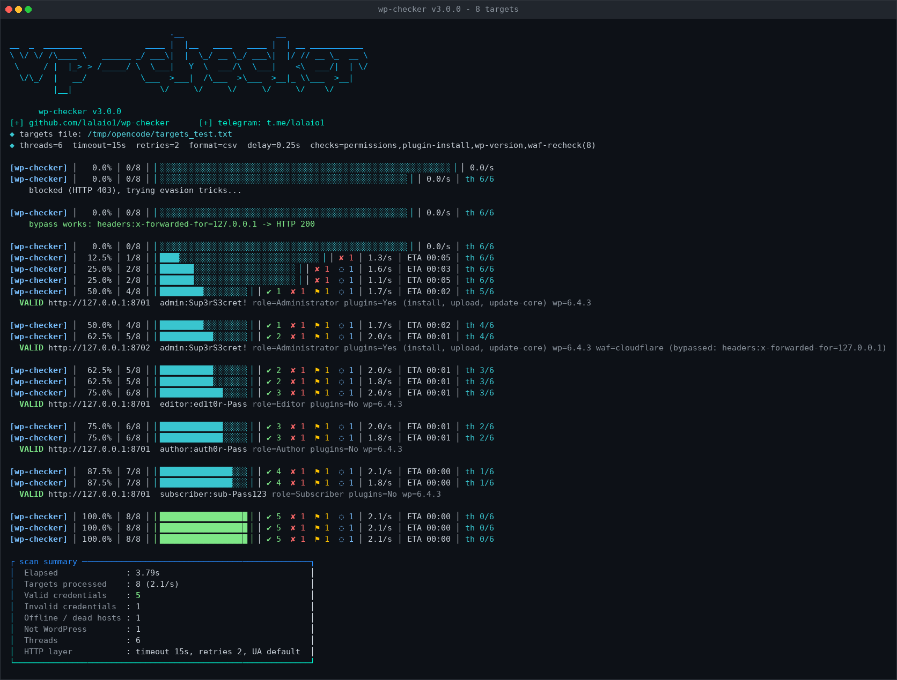
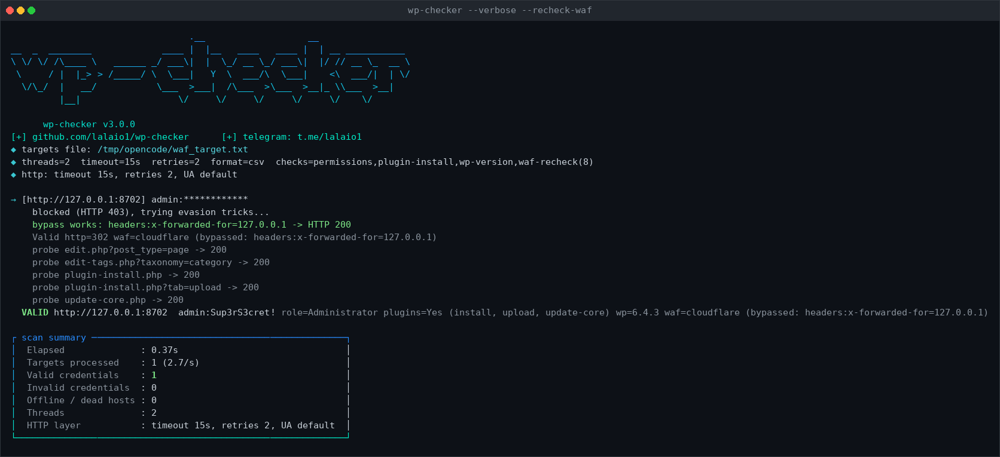
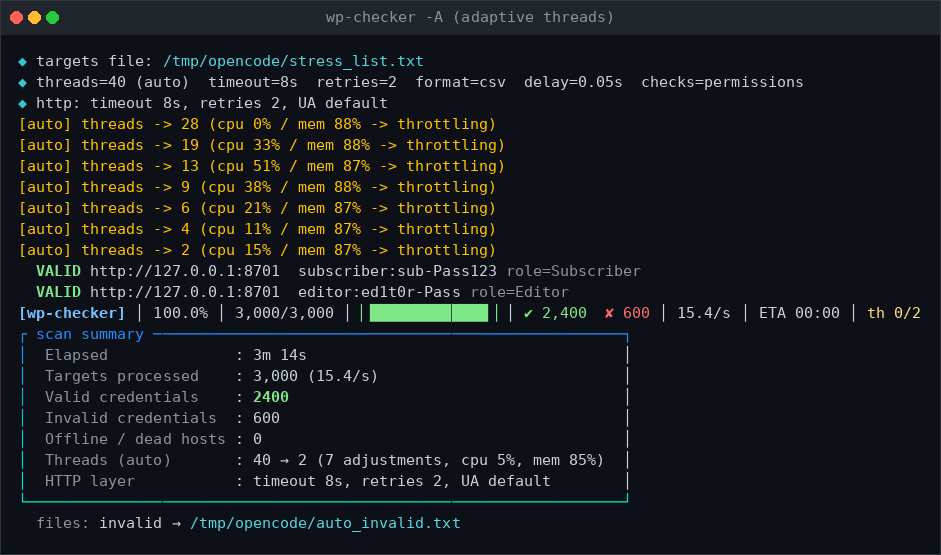

<div align="center">

# 🛠️ wp-checker

**A fast, resilient and feature-complete WordPress credential & permission checker.**

Validates logins, hunts down the real role/capability matrix of every account, checks whether
the user can install plugins, survives WAFs, Tor and dead proxies — while streaming results to
disk so a 500 000 line list will not eat your RAM.

[](version.txt)
[](https://www.python.org/downloads/)
[](#-installation)
[](LICENSE)
[](https://t.me/lalaio1)

[Features](#-features) • [Install](#-installation) • [Quick start](#-quick-start) • [Input format](#-input-formats) • [Output](#-output--reports) • [All flags](#-complete-cli-reference) • [FAQ](#-troubleshooting--faq)

</div>



---

## ✨ Features

| | |
|---|---|
| 🔐 **Credential validation** | Real `wp-login.php` flow: test cookie, POST, redirect and `wordpress_logged_in` cookie verification — no false positives from "200 OK" pages. |
| 👤 **Role & capability discovery** | `--check-permissions` reports the account role (*Administrator*, *Editor*, *Author*, *Contributor*, *Subscriber*, …), the display name, and a **real capability matrix** by probing `wp-admin` pages the account is allowed to open. |
| 🔌 **Plugin install check** | `--check-plugin-install` tells you if the account can install/upload plugins and update the core (`plugin-install.php`, `tab=upload`, `update-core.php`). |
| 🧬 **Version fingerprinting** | `--check-wp-version` reads the version from the homepage generator tag, `readme.html`, RSS `<generator>` and `wp-includes/version.php`. |
| 🛡️ **WAF detection + 403/429 evasion** | 20 WAF fingerprints (Cloudflare, Sucuri, Wordfence, ModSecurity, Imperva, Akamai, F5, LiteSpeed, cPanel, Imunify360, AWS WAF, Vercel, …) and `--recheck-waf` retries blocked requests with IP-spoofing headers, crawler user agents and path normalisation tricks. |
| 🌐 **Scheme negotiation** | Scheme-less targets (the `host/wp-login.php:user:pass` lists floating around) default to `https://` and fall back to `http://` automatically — the working scheme is remembered per host. Reachability checks both ports (80 ↔ 443) and the login POST follows the final URL after redirects (apex→www, subfolder installs). |
| 🧵 **Zero-crash threading** | Thread pool + streaming I/O. The old multiprocessing design that crashed on big lists and low-RAM machines is gone; a 3000 target scan peaks at **~45 MB of RAM**. |
| ⚙️ **Adaptive concurrency** | `-A/--auto-threads` samples CPU and RAM in real time and raises/lowers the thread ceiling (AIMD back-off) so your laptop, Raspberry Pi or phone does not freeze. |
| 📊 **Streaming reports** | `csv`, `json`, `jsonl`, `xml`, `yaml`, `sql` and `parquet`, written row by row — plus ready-to-reuse `valid.txt` / `invalid.txt` / `offline.txt` / `blocked.txt` lists. |
| 🧅 **Tor & proxy rotation** | `--tor` (SOCKS5h, DNS through Tor), circuit rotation every *N* targets, single proxies, proxy files and round-robin/random rotation. |
| 🎭 **User-Agent control** | 39 built-in browsers, `--random-agent`, a fixed `--user-agent`, or bring your own `--user-agent-file`. |
| 🖥️ **Nice on every terminal** | Dependency-free progress bar with counters, ETA, active threads and a *not-WordPress* counter. Auto-detects UTF-8 vs ASCII, truecolor vs 16 colors, and plays nice with `cmd.exe` and Termux. |
| ⏸️ **Ctrl-C friendly** | Partial results are flushed, summary printed, and hanging sockets are abandoned after `--interrupt-grace` seconds. |

---

## 📸 Screenshots

**Verbose mode: WAF bypass, live probes and the final verdict**



**Adaptive threads (`-A`) reacting to real memory pressure (40 → 2 threads in 7 steps)**



---

## 📦 Installation

### Linux

```bash
sudo apt update && sudo apt install -y python3 python3-pip git
git clone https://github.com/lalaio1/wp-checker
cd wp-checker
pip3 install -r requirements.txt
python3 wp-checker.py --help
```

### Windows

1. Install Python 3.9+ from [python.org](https://www.python.org/downloads/) (tick **Add Python to PATH**).
2. Open `cmd` or PowerShell:

```bat
git clone https://github.com/lalaio1/wp-checker
cd wp-checker
pip install -r requirements.txt
python wp-checker.py --help
```

### macOS

```bash
brew install python git
git clone https://github.com/lalaio1/wp-checker
cd wp-checker
pip3 install -r requirements.txt
python3 wp-checker.py --help
```

### Termux (Android)

```bash
pkg update && pkg install -y python git
git clone https://github.com/lalaio1/wp-checker
cd wp-checker
pip install -r requirements.txt
python wp-checker.py --help
```

> **Low-end device?** Add `-A --min-threads 2 --max-threads 10 --max-mem 70` so the scanner
> keeps your phone/laptop responsive while it works.

### Dependencies

| Package | Needed for |
|---|---|
| `requests` | everything (HTTP engine) |
| `beautifulsoup4` | role / display name / capability parsing |
| `PyYAML` | `-f yaml` reports |
| `psutil` *(recommended)* | `-A` CPU/RAM sampling (Linux falls back to `/proc`) |
| `PySocks` *(recommended)* | `--tor` and `socks5://` proxies |
| `pyarrow` *(optional)* | `-f parquet` only |

Nothing else is required: the progress bar, colours and reports are implemented in pure Python.

---

## 🚀 Quick start

```bash
# 1) a simple line: url:user:password
echo "https://example.com:admin:secret" > targets.txt

# 2) scan it, save every category and a CSV report
python3 wp-checker.py targets.txt \
    -v valid.txt -i invalid.txt -off offline.txt \
    -o report -f csv -t 20

# 3) full recon on everything that logs in
python3 wp-checker.py targets.txt \
    --check-permissions --check-plugin-install --check-wp-version \
    -v valid.txt -i invalid.txt -off offline.txt
```

A valid hit looks like this:

```text
VALID https://site.example  admin:secret role=Administrator plugins=Yes (install, upload, update-core) wp=6.4.3
VALID https://site.example  editor:secret role=Editor plugins=No wp=6.4.3
```

and the summary box closes the run:

```text
┌ scan summary ──────────────────────────────────────────────────────────┐
│  Elapsed              : 42.10s                                         │
│  Targets processed    : 350 (8.3/s)                                    │
│  Valid credentials    : 12                                             │
│  Invalid credentials  : 291                                            │
│  Offline / dead hosts : 38                                             │
│  WAF blocked          : 7                                              │
│  Not WordPress        : 2                                              │
│  Threads (auto)       : 40 → 22 (5 adjustments, cpu 41%, mem 78%)      │
│  HTTP layer           : timeout 15s, retries 2, UA random (39 agents)  │
└────────────────────────────────────────────────────────────────────────┘
  files: report → report.csv  |  valid → valid.txt  |  invalid → invalid.txt  |  offline → offline.txt
```

---

## 📋 Input formats

`wp-checker` accepts **two formats, auto-detected, in the same file even**.

### 1. Combo lines

```text
https://example.com:admin:secret
http://example.com:8080:admin:secret
https://example.com/blog:admin:secret           # WordPress in a subdirectory
https://example.com/wp-login.php:admin:secret   # /wp-login.php is stripped
example.com:admin:secret                        # scheme defaults to http://
admin@example.com:secret                        # ('@' kept: usernames can be e-mails)
```

* Everything after the **second** colon is the password, so `p@ss:word:123` works.
* IPv6 targets, custom ports, subdirectories and hosting panels are all handled by URL normalisation.
* One target per line; blank lines and `#`-style noise are ignored.

### 2. Block format (the format this tool writes)

```text
URL: https://example.com
Username: admin
Password: secret
Status: Valid
WP Version: 6.4.3
Role: Administrator
--------
URL: https://other.example
Username: john
Password: hunter2
Status: Invalid
```

The `URL:` / `Username:` / `Password:` trio is what matters — every other field
(`Status`, `WP Version`, `Role`, `Admin`, `Name`, `Capabilities`, `Plugin Install`,
`HTTP Code`, `WAF`, `Error`, `Elapsed`) is preserved/ignored on re-read, so **`valid.txt`
can be fed straight back into the tool** for a second pass.

---

## 📤 Output & reports

### Per-category lists (block format, directly reusable)

| Flag | Contents |
|---|---|
| `-v, --valid FILE` | working credentials |
| `-i, --invalid FILE` | rejected credentials |
| `-off, --offline FILE` | unreachable hosts |
| `--blocked FILE` | WAF/rate-limit blocked targets |

Use `--append` to continue an earlier run instead of overwriting.

### Aggregated report

`-o NAME -f FORMAT` (default `report.csv`), written incrementally:

| Format | Extension | Notes |
|---|---|---|
| `csv` | `.csv` | UTF-8 **with BOM** → opens cleanly in Excel |
| `json` | `.json` | array of objects, streamed |
| `jsonl` | `.jsonl` | one object per line — perfect for `jq`/`grep` |
| `xml` | `.xml` | `<sites><site>…</site></sites>` |
| `yaml` | `.yaml` | multi-document YAML |
| `sql` | `.sql` | portable `INSERT` dump (SQLite/MySQL/PostgreSQL) |
| `parquet` | `.parquet` | columnar (needs `pyarrow`) |

### Record fields

| Field | Example | Meaning |
|---|---|---|
| `url` | `https://example.com` | normalised base URL |
| `username` / `password` | `admin` / `secret` | credentials tested |
| `status` | `Valid` | see the status table below |
| `wp_version` | `6.4.3` | with `-cwv` |
| `role` | `Administrator` | with `-perm` |
| `admin` | `Yes` / `No` | administrator account? |
| `name` | `admin` | display name (`display-name` in the admin bar) |
| `capabilities` | `manage_options, list_users, …` | capabilities proven by live probes |
| `plugin_install` | `Yes (install, upload, update-core)` | with `-pi` |
| `http_code` | `302` | last meaningful HTTP status |
| `waf` | `cloudflare (bypassed: headers:x-forwarded-for=127.0.0.1)` | detected WAF + bypass used |
| `error` | `ConnectTimeout: …` | why the target failed |
| `elapsed` | `1.93` | seconds spent on the target |

### Status meanings

| Status | Meaning |
|---|---|
| `Valid` | the login really succeeded (redirect to `wp-admin` and/or `wordpress_logged_in` cookie) |
| `Invalid` | `wp-login.php` answered the form → wrong password / unknown user |
| `Blocked` | 403/406/429/503/… or a WAF interstitial (with `-w`, evasion is attempted first) |
| `Offline` | TCP connect failed — the host is down/unreachable |
| `NotWordPress` | `wp-login.php` does not exist (404/410) |
| `Error` | transport problem (dead proxy, Tor not running, TLS failure…) |

---

## 🔎 Permission & plugin checks

With `-perm` the tool opens `wp-admin` **as that account** and probes the menu/pages that
each capability unlocks:

| Capability | Probe | Typical role |
|---|---|---|
| `manage_options` | `options-general.php`, `update-core.php` | Administrator |
| `list_users` | `users.php` | Administrator |
| `activate_plugins` | `plugins.php`, `plugin-install.php` | Administrator |
| `edit_posts` / `edit_pages` | `edit.php`, `edit.php?post_type=page` | Editor / Author |
| `upload_files` | `upload.php` | Editor / Author |
| `moderate_comments` | `edit-comments.php` | Editor |
| `manage_categories` | `edit-tags.php` | Editor / Author |

The role is derived from the capability fingerprint (with `xmlrpc.php`-style fallbacks removed —
everything is verified through real HTTP probes), and the display name is taken from the
`display-name` element in the admin bar:

```text
VALID https://site.example  admin:secret role=Administrator plugins=Yes (install, upload, update-core) name=admin
VALID https://site.example  john:secret  role=Editor        plugins=No
VALID https://site.example  jane:secret  role=Subscriber    plugins=No
```

`-pi` is the *interesting* one for a real engagement: it answers “can this account upload a
malicious plugin / update the core to a vulnerable version?”.

---

## 🛡️ WAF detection & evasion

`--recheck-waf` (short `-w`) is used when a request is blocked
(`403 406 409 418 429 503 520…524 999`):

1. **Detection** — 20 fingerprints (Cloudflare, Sucuri, Wordfence, ModSecurity, Imperva/Incapsula,
   Akamai, F5, Barracuda, DDoS-Guard, Qrator, AWS WAF, Fastly, StackPath, Vercel, Netlify,
   LiteSpeed, cPanel, Imunify360, WP-Secure, generic).
2. **Evasion ladder** (`--recheck-attempts`, default 8), ordered fastest-first:
   * IP spoofing headers many edge rules trust: `X-Forwarded-For`, `X-Real-IP`,
     `X-Originating-IP`, `X-Remote-Addr`, `X-Client-IP`, `X-Custom-IP-Authorization`,
     `Forwarded`, `X-Forwarded-Host`;
   * `X-Original-URL` / `X-Rewrite-URL` / `X-Forwarded-Prefix` rewrites;
   * whitelisted crawler agents (`Googlebot`, `bingbot`) and `curl`;
   * path normalisation: `//`, `/.//`, `/%2e/`, upper-case path, `%20` suffix, `;` suffix,
     `%2f`, `?/`, `//` suffix, cache-busting query.
3. **Session continuity** — once a trick works, its headers are re-used for the login POST and
   the permission/plugin probes of that same target, so the whole recon happens *through* the bypass.
4. The successful trick is recorded in the `waf` column, e.g.
   `cloudflare (bypassed: ua:googlebot)`.

> Run it only against systems you are authorised to test. These are non-destructive requests,
> but privilege escalation attempts are still privilege escalation attempts.

---

## 🧅 Tor, proxies & stealth

```bash
# everything through Tor (DNS resolved by Tor too), new circuit every 50 targets
sudo apt install tor && sudo systemctl start tor
python3 wp-checker.py targets.txt --tor --tor-rotate 50 -t 5 -d 1

# a single HTTP/SOCKS proxy
python3 wp-checker.py targets.txt --proxy socks5://127.0.0.1:1080

# rotate through a proxy list (round-robin or random)
python3 wp-checker.py targets.txt --proxy-file proxies.txt --proxy-random

# stealth preset
python3 wp-checker.py targets.txt --tor --random-agent -d 1.5 --recheck-waf --timeout 30 -t 10
```

`proxies.txt` accepts one proxy per line (`host:port`, `user:pass@host:port`,
`http://…`, `socks5://…`, `socks5h://…`); bad proxies are skipped automatically.

---

## ⚙️ Performance & adaptive threading

Three things make this version usable on real hardware:

1. **Threads instead of processes** — the workload is network-bound, so a thread pool gives the
   same speed with a fraction of the RAM (no forks, no per-worker re-import of `requests`/`bs4`).
2. **Streaming input *and* output** — targets are parsed lazily and every result is written as
   soon as it exists, so nothing is accumulated in memory.
3. **`-A/--auto-threads`** — a monitor samples CPU/RAM every second and adjusts the concurrency
   ceiling (×0.7 when over `--max-cpu`/`--max-mem`, +25 % when relaxed, with a cooldown).

Measured on a 4 vCPU / 3.6 GB Debian VM (Python 3.13, local targets, `--check-permissions`):

| Scenario | Result |
|---|---|
| 3 000 targets, 40 threads | **14.9 s → ~200 targets/s**, peak RSS **45 MB** |
| 500 000-line list parsed with `--dedupe` | 3.2 s, peak RSS 56 MB (0.8 s without dedupe) |
| `-A` under memory pressure (87 % used) | 40 → 2 threads in 7 steps, machine stayed responsive |
| Ctrl-C mid-scan | partial reports flushed in ≤ `--interrupt-grace` (default 5 s) |

Real-world scans are naturally slower: every dead host costs a TCP timeout, and WAF evasion
retries add requests — expect ~3-15 targets/min/thread against mixed internet hosts.

---

## 📖 Complete CLI reference

```text
python3 wp-checker.py <file> [options]
```

### Output

| Flag | Default | Description |
|---|---|---|
| `-v, --valid FILE` | – | save valid credentials (block format) |
| `-i, --invalid FILE` | – | save invalid credentials |
| `-off, --offline FILE` | – | save unreachable hosts |
| `--blocked FILE` | – | save WAF-blocked targets |
| `-o, --output NAME` | `report` | report name without extension |
| `-f, --format` | `csv` | `csv` `json` `jsonl` `xml` `yaml` `sql` `parquet` |
| `-od, --output-dir DIR` | `.` | directory for the report |
| `--no-report` | off | skip the aggregated report |
| `--append` | off | append to the `-v/-i/-off/--blocked` files |

### Checks

| Flag | Description |
|---|---|
| `-cwv, --check-wp-version` | detect the WordPress version of valid hosts |
| `-perm, --check-permissions` | role, display name and capability matrix |
| `-pi, --check-plugin-install` | can the account install/upload plugins and update core? |
| `-s, --skip-ping` | skip the TCP reachability probe (faster) |
| `--ping-timeout SEC` | TCP probe timeout (default `6`) |
| `-w, --recheck-waf` | retry blocked requests with evasion tricks |
| `--recheck-attempts N` | max evasion attempts per blocked request (default `8`) |

### Performance

| Flag | Default | Description |
|---|---|---|
| `-t, --threads N` | `10` | worker threads |
| `-A, --auto-threads` | off | adapt concurrency to CPU/RAM in real time |
| `--min-threads N` | `2` | lower bound for `-A` |
| `--max-threads N` | `100` | upper bound for `-A` |
| `--max-cpu PCT` | `85` | CPU ceiling for `-A` |
| `--max-mem PCT` | `85` | RAM ceiling for `-A` |
| `-d, --delay SEC` | `0` | delay between requests |
| `--limit N` | `0` (all) | stop after N targets |
| `--dedupe` | off | skip duplicated `url:user:password` triples |

### Network, stealth & evasion

| Flag | Default | Description |
|---|---|---|
| `--timeout SEC` | `15` | HTTP read timeout |
| `--connect-timeout SEC` | `6` | HTTP connect timeout |
| `--retries N` | `2` | network-level retries per request |
| `-ua, --user-agent UA` | – | fixed User-Agent |
| `-ra, --random-agent` | off | random UA per target (39 built-ins) |
| `--user-agent-file FILE` | – | your own UA list (with `-ra`) |
| `--proxy URL` | – | single proxy (`http://`, `socks5://`, `socks5h://`) |
| `--proxy-file FILE` | – | proxy list |
| `--proxy-random` | off | random instead of round-robin |
| `--tor` | off | route everything through Tor |
| `--tor-host HOST` | `127.0.0.1` | Tor SOCKS host |
| `--tor-port PORT` | `9050` | Tor SOCKS port |
| `--tor-control-port PORT` | `9051` | Tor control port (circuit rotation) |
| `--tor-password PASS` | – | Tor control password (if not cookie auth) |
| `--tor-rotate N` | `0` | new circuit every N targets |
| `--no-verify` | off | skip TLS verification |

### Interface

| Flag | Default | Description |
|---|---|---|
| `--verbose` | off | print every request/decision |
| `--progress {auto,plain,none}` | `auto` | bar mode (`plain` = ASCII-safe) |
| `--no-color` | off | disable ANSI colours |
| `--no-banner` | off | hide the ASCII banner |
| `--log-file FILE` | – | also write the debug log to a file |
| `--interrupt-grace SEC` | `5` | time to wait for running requests after Ctrl-C |
| `--version` | – | print the version |

Exit codes: `0` success · `1` unexpected error · `2` bad usage/setup · `130` interrupted.

---

## 🧪 Recipes

```bash
# 1. Big list on a weak laptop: survive, do not freeze
python3 wp-checker.py big_list.txt -A --min-threads 2 --max-threads 12 --max-mem 70 \
    -v valid.txt -i invalid.txt -off offline.txt --dedupe

# 2. Full recon, JSONL report, only the first 500 targets
python3 wp-checker.py list.txt --limit 500 --dedupe \
    --check-permissions --check-plugin-install --check-wp-version -w \
    -f jsonl -od out -o recon

# 3. Only re-test the hosts that were offline / blocked earlier
python3 wp-checker.py offline.txt -off still_offline.txt -v valid.txt -A -w

# 4. Quiet background scan through Tor + proxies
python3 wp-checker.py list.txt --tor --tor-rotate 100 --proxy-file proxies.txt \
    --random-agent -d 2 -t 8 --progress none --log-file scan.log -od out

# 5. Sanity-check one credential, extremely verbose
echo "https://example.com:admin:test" > one.txt
python3 wp-checker.py one.txt --verbose --progress none -perm -pi -cwv

# 6. Re-run only the accounts that worked, to double check their role
python3 wp-checker.py valid.txt --dedupe -perm -pi -o verified -f csv --append
```

---

## 🩺 Troubleshooting & FAQ

<details>
<summary><b>The scan is slow — is something wrong?</b></summary>

Dead hosts and firewalled ports consume the full `--timeout`. Use `--timeout 8`,
`--connect-timeout 4`, `-s` (skip ping) and `-A`. If a host is genuinely slow, raise the
timeout instead — but the per-target `elapsed` column will show you who the culprits are.
</details>

<details>
<summary><b>Everything says "Offline" when I use <code>--tor</code> or <code>--proxy</code>.</b></summary>

That means the transport itself is failing, and the tool now reports those as **Error**
(with the exception text in the report) instead of blaming the target. Check that Tor is
running (`ss -ltnp | grep 9050`) or that the proxy is alive.
</details>

<details>
<summary><b>Many sites return <code>Blocked</code> — can I get through?</b></summary>

Add `-w` (evasion retries). Cloudflare-protected hosts usually need a real browser session;
the tool's job is to tell you *why* it is blocked (`waf` column) so you can escalate
(manual browser, residential proxy, `curl` with the exact headers).
</details>

<details>
<summary><b>The tool reports "Not WordPress" for a site I know runs WordPress.</b></summary>

The site may block `/wp-login.php` (renamed login, security plugin, or a 403 WAF page).
Check the record's `http_code`/`waf` columns — a `403` is not "not WordPress".
</details>

<details>
<summary><b>Will it overwrite my result files?</b></summary>

Yes, unless you pass `--append`. Use `-od out/` to keep reports tidy and never point
`-o` at an important file.
</details>

<details>
<summary><b>How do I get a parquet report?</b></summary>

`pip install pyarrow` and use `-f parquet`.
</details>

<details>
<summary><b>Why is the progress bar plain in <code>cmd.exe</code>?</b></summary>

The bar auto-falls back to ASCII (`#`, `-`, `V/I/O/B/N`) when UTF-8 is unavailable.
Force either mode with `--progress plain` (ASCII) or `--progress auto` (default).
</details>

---

## ⚖️ Legal notice

This project is published **for authorised security testing, penetration testing engagements,
CTF/lab environments, and academic research**. You must have explicit written permission to test
any system you point it at. The authors are not responsible for misuse or damage caused by this
program. Credential stuffing and unauthorised access are crimes in most jurisdictions — do not be
the person who finds out the hard way.

---

## 💬 Contact & contributing

* Telegram: **[t.me/lalaio1](https://t.me/lalaio1)**
* Issues / feature requests: [GitHub issues](https://github.com/lalaio1/wp-checker/issues)
* PRs welcome — keep the style (type hints, docstrings, no new hard dependencies).

If this tool saved you time, a ⭐ on the repository is appreciated.

<div align="center">

**License: [Apache-2.0](LICENSE)**

</div>
